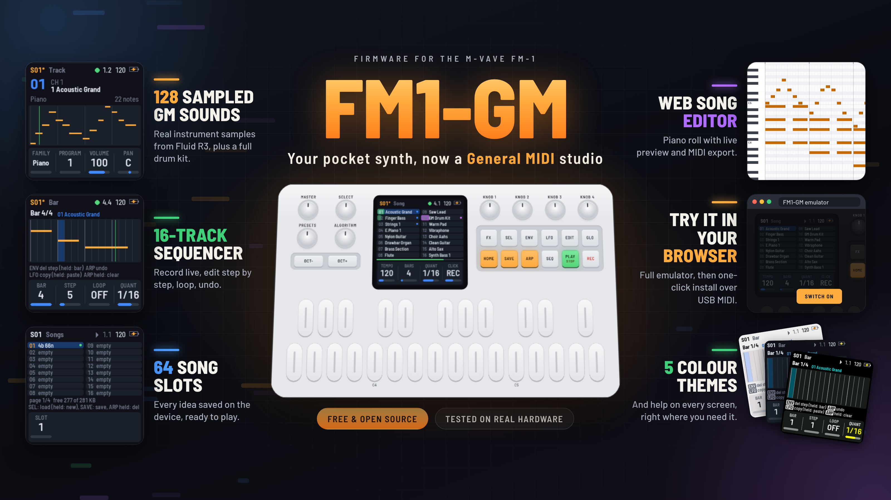

# FM1-GM

> [!CAUTION]
> **Safety notice:** firmware versions up to and including 0.9.8 can make a sudden, very loud noise when the highest notes are played, from the keys, over MIDI or in a song. Please update to the latest version (https://github.com/jartificer/fm1-gm/releases). Releases older than 0.9.9 have been deleted.
>
> Do not try to reproduce the problem: the noise is loud enough to damage speakers, headphones or your hearing.

Custom firmware that turns the M-VAVE FM-1 into a General MIDI sound module and 16-track sequencer.



- **128 General MIDI programs** (the full GM1 sound set, fixed, not editable) and a **GM drum kit** (notes 35–81) on channel 10.
- **16 tracks, each on any of the 16 MIDI channels**, with program, volume, pan, reverb, transpose and velocity per track.
- **64 song slots sharing all of the device's free data flash** (284 KB, roughly 100,000 notes), power-safe (a save never touches the song it replaces until it is complete; CRC-checked).
- Real-time recording with overdub, quantize and count-in, plus step recording, undo, mute and solo.
- **Bar editing:** pick a bar and a step; change the length of the step's notes (all of them, or the ones whose keys you hold), loop the bar, delete a step, copy, paste, clear or delete a bar. Undo covers all of it.
- MIDI in (USB and the TRS jack) plays the sounds; MIDI out and clock out over USB are optional.
- A battery indicator, and five screen colour schemes, two of them for colour-blind players.

It is built on [Felucca](https://github.com/hugelton/Felucca)'s FM-1 platform, through [X0X](https://github.com/charlesvestal/fm1-x0x) and [FoMni](https://github.com/charlesvestal/fm1-fomni). The sound engine, the sequencer, the song storage and the screens are new.

> **Status: tested on a real FM-1 by the author, and it works.** Everything also runs and is tested in the host simulator (`tests/run_tests.sh`). The firmware comes with no warranty: see [No warranty](#no-warranty) before you install it.

## Emulator and firmware loader

You can use the following website to test out the firmware in your browser. On Chromium-based browsers, you can connect your FM1 via USB (use one of your main ports, not a USB hub) and load the FM1-GM firmware directly from the website.

https://jartificer.github.io/fm1-gm/

## Song editor

`web/editor.html` (linked from the emulator page - https://jartificer.github.io/fm1-gm/editor.html ) edits FM1-GM songs in the browser: the tempo, bars and quantize, each track's channel, program, volume, pan, reverb, velocity, transpose, mute and solo, and each track's notes in a piano roll. It works without an FM-1, on `.fm1song` files, which are the song's bytes exactly as the FM-1 keeps them in flash.

- **Preview:** Play (or Space) plays the song in a loop with the firmware's own sound engine and samples, the same WebAssembly build the emulator runs, so it sounds as the FM-1 would. Edits are heard as it plays, and a note sounds when you add it, click it or move it to another pitch. Click the ruler to choose where Play starts.
- **On the FM-1:** with the FM-1 connected over USB (Chrome, Edge or Opera, which have Web MIDI with SysEx), Connect FM-1 lists its 64 slots. Open in editor reads a slot (or the song the FM-1 has in memory, saved or not); Write editor song here saves the editor's song to a slot, and the FM-1 switches to it (its song before is one press of ARP away); Delete empties a slot. With the emulator open in another tab, Use the emulator does the same with the emulator's songs. This needs FM1-GM from this version on: older versions do not answer the editor.
- **MIDI:** Export MIDI writes a Standard MIDI File (type 1, 48 ticks a quarter note) of one pass through the song: GM System On, the tempo, then a track for each track with notes, with its program, volume, pan and reverb, its transpose applied (the drums' too) and its velocity on every note. Notes past the song's end are left out, as the FM-1 does not play them. MIDI files cannot be imported.

The editor and the FM-1 talk SysEx (`F0 7D 46 47 ...`, 7D being MIDI's ID for non-commercial use): the protocol is described at the top of `firmware/src/app/link.c`, and `web/fm1link.js` is its host side.

## The sounds

The sounds are samples from the Fluid R3 GM SoundFont by Frank Wen (MIT License). The full SoundFont is 141 MiB and the FM-1 has about 440 KiB of flash left after the firmware, so `tools/sf2_reduce.py` cuts it down to `assets/soundfont/fm1gm.sf2`, a normal SoundFont you can play in any SoundFont player.

- **One sample per instrument.** For each program it keeps the sample FluidR3 plays at the instrument's middle key (one velocity layer, mono). Every sample, drums included, is at the same rate, 14.7 kHz (a third of 44.1 kHz), so every instrument has the same top end and the same noise floor. The same sample plays across the whole keyboard, so an instrument sounds like itself in every register.
- **The attack, then a seamless loop.** It keeps the sample's first 0.05–0.15 s (it depends on the family), then a loop:
  - For the standard instruments (pianos, organs, accordions, guitars, basses, strings, choirs, brass, reeds and flutes), the loop comes from wherever in the first 4 s of the recording the tone is steadiest. A piano's or a guitar's tone keeps changing for a second or two after the attack, and a loop taken from inside that change comes back to its start at every pass, which sounds like an echo or a retrigger. The loop is spliced on after the attack with a 60 ms crossfade, in step with the attack's waveform and at its level.
  - The loop is at least 0.25 s long (0.25, 0.37 or 0.5 s are tried, the last two for a vibrato's whole cycles), so whatever still changes inside it is slow and not a buzz. Each extra second of sample counts against a loop, so the longer ones go only where they help. Slow swells and beats in the level (a drawbar organ's, an ensemble's) are evened out within the loop, or they would come back at the loop's rate, as a tremolo.
  - The other instruments keep a shorter loop (0.12–0.25 s) just after the attack, to leave flash for the firmware.
  - A few take a longer loop from later in the recording. The acoustic guitars, Pick Bass and both Slap Basses take a 0.4–0.5 s loop from at least 0.8 s in (Steel Guitar from 1.5 s), past the pluck or slap. Synth Voice, both Synth Brasses, Oboe, English Horn, Bassoon and Fiddle take a loop of 0.45–0.7 s. Where FluidR3's recording ends early in a short loop of its own (the reeds, the violin), the loop is taken from before that point, or it would repeat as often as FluidR3's short one. Bassoon and Fiddle use the key with FluidR3's longest recording.
  - It holds a whole number of the note's periods exactly. The sample is resampled by a hair so that the periods come out to whole sample points, so each pass picks up exactly in step with the last.
  - The loop is tuned: its pitch is measured across the whole loop and the sample's tuning corrected so that it sits on its note. Some of FluidR3's samples are a few cents off (its 440 Hz synth saw is 13 cents flat).
  - Its length (within a quarter of the target) and start are searched for where the seam's two sides match best. This also catches the cycle of a vibrato or chorus recorded in the sample.
  - The sample's own fade across the loop is taken out, octave band by octave band, and the volume envelope does the fading instead. A piano's top end fades faster than its body, so a loop that only held the overall level would brighten again at every seam, as if the note were struck anew.
  - Where a sound's level still swells or dips after its attack (choirs, some pads and leads), the loop may start up to 0.15 s later, where the level is smoother, if that makes the seam step less.
  - The seam is crossfaded with what comes just before the loop. Its length (7–30 % of the loop, at least 6 ms) is searched along with the loop: over two sides that don't quite match, a long crossfade sounds like a short echo (both heard at once), so most seams use a short one (about 10–20 ms) and only closely matching sides get a long one. The crossfade keeps the level steady however alike the two sides are: linear for a steady tone, equal power for noise.
- **Instruments with their own timing.** Harmonica and Alto Sax start a little flat and slide up to pitch, so their loops start after the slide (and Alto Sax's holds a whole cycle of its vibrato). Contrabass has a longer loop (0.4 s) for its bowing. Fifth Sawtooth mixes FluidR3's four layers (a saw and a saw a fourth below, each as a pair a few cents apart), and its 0.8 s loop holds one whole slow beat between them.
- **Shallower vibrato.** Alto Sax, Violin and Fiddle have a deeper vibrato recorded than the instruments next to them. Their loops are evened out by 40 %, 100 % and 85 %: they play slower where the pitch is sharp and faster where it is flat, and each octave band is held nearer its own level (a bowed or blown vibrato also swings the harmonics' levels). Violin's sample is FluidR3's from A♭4, the middle of the range a violin is played in, with a 0.5 s loop: one from lower down, raised an octave and more, made its vibrato a fast flutter.
- **Honky-tonk Piano** plays the grand piano's sample twice a key, 18 cents apart, so the pair beats like a honky-tonk's two strings (FluidR3 detunes its two layers by only 5 cents).
- **Short recordings.** When FluidR3's recording is shorter than an attack and a loop (Tuba, the synth saws and squares), the whole recording plays and then its own short loop holds, as FluidR3 plays it.
- **Exceptions.** Sounds that die away within about half a second (xylophone, woodblock, pizzicato) and bells without a clear pitch (glockenspiel) keep their sample without a loop.

Plucked and struck instruments (pianos, guitars, basses, harp, pizzicato, sitar, banjo, shamisen, koto) stop within half a second when the key is let go, the way a damper stops a string. FluidR3 lets some of them ring on for up to 4 s.

FluidR3's vibrato and tremolo are left out, which removes the wobble in the upper registers. The exception is Tremolo Strings, which plays Strings' sample with FluidR3's tremolo (2.5 dB, 24 Hz), the only thing that sets it apart. The mod wheel (CC1) still adds vibrato. The SoundFont's volume envelope, low-pass filter and filter envelope, and tuning still apply.

Each instrument and drum is as loud as it is in FluidR3 played by FluidSynth. `tools/gm_levels.py` plays three notes of each program (and each drum) both ways, compares their level over the first 1.5 s, and writes the difference to `assets/soundfont/fm1gm_levels.json`, which `sf2_reduce.py` applies to each zone's attenuation. The levels now match to 0.5 dB RMS. Only Reverse Cymbal stays 6 dB quiet, because its swell is longer in FluidR3 than its loop here.

The drum kit is FluidR3's standard kit, notes 35–81. Each drum keeps its sample until it has died away by 36 dB (at most a quarter second). Cymbals and other long drums are looped the same way and fade. Open and closed hi-hats choke each other, as do the other groups FluidR3 marks.

The build stores the samples as 4-bit ADPCM (59 kbit/s each), 430 KiB in all. Samples with the same points (Synth Brass 1 and 2, say) are stored once. The firmware plays them back through an 8-point windowed-sinc interpolator: at a sample's own pitch it is flat up to about 4.4 kHz, and it keeps the images of everything below that 50–60 dB down. A straight line between points, or a cubic, leaves those images only 17–19 dB down, which sounds like a fizz over the sound. When the audio gets close to running late (a render over 70 % of its time), every voice falls back to straight-line interpolation until the load has stayed low for 3 s. Only if a render is late even then does the quietest voice drop.

A shared reverb follows CC91 (channel and track reverb send).

GM controllers: note on/off, program change, pitch bend (with RPN 0 bend range), CC1 modulation, CC7 volume, CC10 pan, CC11 expression, CC64 sustain, CC91 reverb, CC120/121/123.

## Using it

The screen has six views. EDIT or GLO again flips its view's four knobs to their second page; HOME again goes between Song and Bar.

| Button | |
|---|---|
| HOME | **Song** view: the 16 tracks. Knobs: tempo, bars, quantize, click. HOME again: **Bar** view (below) |
| EDIT | **Track** view: piano roll of the selected track. Knobs: family, program, volume, pan / channel, reverb, transpose, velocity |
| FX | **Mix** view: 16 strips. Knobs: the volumes of the selected track's group of four (1–4, 5–8, …) |
| SEL | **Songs** view: 16 slots at a time (of 64) and the room left. SEL again loads the highlighted slot; hold ARP twice to delete it; hold SEL twice for a new song |
| GLO | **Setup**. Knobs: MIDI in mode, MIDI out, clock out, count-in / voices, click volume, lights, colours |
| PLAY | Play / stop |
| REC | Arm recording (overdub, with a one-bar count-in when it is on) |
| SEQ | Step recording on / off (stopped) |
| SAVE | Save to the current slot; in the Songs view, to the highlighted slot (a used slot asks twice) |
| ENV | Mute the selected track |
| LFO | Solo the selected track; in step recording, step back |
| ARP | Undo / redo the last recording or erase; hold 1 s to erase the track; in step recording, a rest |
| OCT- / OCT+ | Keyboard octave, −3..+3 |

Encoders: **SELECT** picks the track (or the slot in the Songs view), **ALGORITHM** the program of the selected track, **PRESETS** the tempo.

The keys play the selected track. On a drum track (channel 10) the keys are the GM kit laid out as on any GM keyboard, two octaves down: the two kicks are on B and C (notes 35 and 36), the snare on D, the closed hi-hat on F#, and so on up. At octave 0 the keys reach from the kicks to note 55 (Splash Cymbal); OCT+ moves up the kit, and +3 reaches its top (81, Open Triangle). The track's transpose moves the drums too: +6 puts Acoustic Bass Drum back on the lowest key, as in earlier versions. MIDI out sends, and MIDI in plays, the GM drum notes as they sound (with the track's transpose, which is 0 unless you set it).

Loading a different song while the current one has changes asks for a second SEL.

**A new song:** in the Songs view, hold SEL for a second, then again. Every note goes and every track and setting returns to its default (programs, volumes, tempo, bars, quantize); the slot stays the same and nothing in flash changes until you save. ARP undoes it.

**Colours:** Setup's second page (GLO twice), knob 4. DARK (the default), LIGHT, HI-CON (high contrast: black, white and saturated colours), RED-GRN (for red-green colour blindness: no red against green; playing is blue and recording vermilion, from the Okabe–Ito palette) and BLU-YEL (for blue-yellow colour blindness: red against cyan). The choice is saved with the settings.

**Battery:** the icon at the top right shows three bars, two, one (orange) or none (red), from the battery's voltage. A bolt means a USB host is powering the FM-1.

**MIDI in** has two modes, set in Setup. TRACK (the default) plays whatever arrives on the selected track, with its sound, so a keyboard records into the track you are on. MULTI plays each channel as sent, as a GM module; channel 10 is drums. MIDI Start and Stop start and stop the sequencer.

### Recording

Press REC, then PLAY (or PLAY then REC). The click counts in a bar, then the loop plays and what you play is recorded into the selected track, quantized to the Quantize setting (OFF, 1/4 … 1/32). Recording loops and overdubs. ARP undoes the last pass.

Step recording: stop, press SEQ, then play a note (or a chord) to place it at the step and move on by the quantize value. ARP inserts a rest, LFO steps back, SEQ finishes.

### Editing a bar

Press HOME twice for the **Bar** view: one bar of the selected track, close up, divided into steps of the quantize value (16 steps at 1/16). It opens at the bar playing, or where the step cursor is.

| Control | |
|---|---|
| KNOB 1 | The bar |
| KNOB 2 | The step (it is also where step recording starts: press SEQ) |
| KNOB 3 | Length of the notes that start in the step, in steps (1/16 steps at 1/16): turn it to make them longer or shorter, a step at least. It shows the longest one's length, or "-" when the step has none. Hold a note's key while you turn it to change only that note (hold several keys for several notes); the notes picked are outlined. Any key you hold in this view lights its row across the bar and its notes in it, so you can see where a pitch is. A note can be longer than its bar: it ends in a > where the bar ends, and the bars it is still held in show it from their start with a <. ARP undoes the changes made at a step in one go |
| KNOB 4 | Quantize, which sets the step size |
| HOME held 1 s | Loop: playback and recording stay in this bar until you hold HOME again or leave the view. While it is on, the bar is framed in green, LOOP ON shows beside the bar number and HOME's light blinks |
| ENV | Delete the step's notes (the selected track) |
| ENV held 1 s | Delete the bar from the song, all tracks; the bars after it move up |
| LFO | Copy the bar (the selected track) |
| LFO held 1 s | Paste the copied bar over this one |
| ARP held 1 s | Clear the bar (the selected track) |
| ARP | Undo the last of these (again: redo) |

Mute and solo are on the other views. To add a bar at the end, turn up Bars in the Song view.

## Defaults chosen where the hardware or the request was open

- **128 programs, not 127.** GM1 has 128 (0–127), so all of them are here.
- **Polyphony: 16 melodic + 8 drum voices**, GM1's minimum. Setup → Voices allows 8..24 melodic voices. If the render runs over 85 % of its time budget, the quietest voice is dropped rather than letting audio break up.
- **Song length:** 1–128 bars of 4/4, 48 PPQN, up to 8192 notes per song across all tracks, 30–300 BPM.
- **No velocity in songs.** The FM-1 keys are not velocity-sensitive, so each track has one velocity (default 100) and every note it plays uses it. Notes from MIDI in are recorded without velocity too, and in TRACK mode they also sound at the track's velocity, so you hear what will play back. In MULTI mode MIDI in sounds as sent.
- **No chorus.** CC93 is accepted and ignored, to keep CPU for voices.
- **One velocity layer.** MIDI velocity sets the level only; the samples are FluidR3's velocity-100 layer. Above velocity 100 the level rises as it does in FluidSynth, so hard hits (most often the drums) are as loud as there; below it, it falls more gently, so soft parts stay a little louder.
- **No external clock sync.** MIDI Start and Stop are followed, the tempo is the song's own.
- **Notes only are recorded** (no velocity, controllers or bend); per-track volume, pan and reverb are part of the song.
- **Song format.** A song is stored like a stripped-down MIDI file: the song and track settings (133 bytes), then per track its notes as delta time, note and length, with MIDI's variable-length numbers, and the length left out when it repeats (like MIDI running status). That is 2 to 4 bytes a note; a step-recorded song averages about 2.
- **Song storage.** The songs share every free sector of the data area, 0x97000–0xDFFFF apart from the panel calibration at 0xDC000: 71 sectors of 4 KiB, 4064 bytes of song each. A song takes as many sectors as it needs, so one small song is one sector and a long song can use most of the store. A save writes the new version to free sectors and only then lets go of the old one, so resaving a song needs room for it once more. Settings are at 0xFC000. The stock firmware's patches at 0xEA000–0xFBFFF (72 KB) and the update staging area at 0xE0000 are left untouched; the patch area could be given to songs too (about 25 % more room), at the cost of the stock firmware's saved patches.
- **Package identity FM-1_600** (release builds FM-1_6XXYYZZ), apart from FoMni (FM-1_8…) and X0X (FM-1_9…).

## No warranty

FM1-GM is provided "as is", without warranty of any kind, express or implied, including the implied warranties of merchantability and fitness for a particular purpose. Installing custom firmware can leave a device unable to start ("bricked") and may void its warranty. You install it at your own risk: the author is not responsible for a bricked or damaged device, lost songs or data, or any other harm that comes from using it. This is the same disclaimer as sections 15 and 16 of the [GPL-3.0](LICENSE), which governs. Know the [recovery steps](#recovery) before you install.

## Installing

Get `fm1gm.fwsc` from the CI artifacts (Actions → build) or build it yourself (see [BUILDING.md](BUILDING.md)). Then, with the FM-1 connected over USB:

```
pip install mido python-rtmidi
python3 tools/fm1_install.py fm1gm.fwsc
```

This works from the stock firmware or any Felucca-based firmware. To go back, install M-VAVE's stock package the same way, or with M-VAVE's updater.

Or from the browser: the web page in `web/` installs over Web MIDI in Chrome, Edge or Opera on a computer (the same update as `fm1_install.py`). See "In the browser" below.

Holding OCT- and OCT+ for 5 seconds puts FM1-GM into update mode, for an installer that cannot reach it otherwise.

### Recovery

After two failed starts in a row the firmware comes up in a safe mode with USB on and no audio, so an installer can reach it; PLAY tries the firmware again. After four, it enters the chip's own update mode, the last resort: `tools/fm1_rescue.py` writes the stock firmware back through it (see the script's header and [FM-1-transporter](https://github.com/kurogedelic/FM-1-transporter)).

## In the browser

`web/` is a page with the firmware running in the browser and the installer, and the song editor (`editor.html`). The emulator is the app, the sequencer and the sound engine compiled to WebAssembly from the same sources (`host/gm_web.c`, built by `host/build_web.sh`); songs you save are kept in the browser. The installer finds the FM-1 over Web MIDI (it needs SysEx permission) and installs the package that comes with the page, or one you choose.

To use it on your own machine:

```
cd web && python3 -m http.server 8000      # then open http://localhost:8000
```

It also works as a static site (GitHub Pages or any web host). The page needs to be served over https or from localhost: Web MIDI and the audio worklet do not work from a `file://` page.

## Developing

```
tests/run_tests.sh          # host tests and the simulator scenarios (needs cc and Python with Pillow)
sh host/build_host.sh       # the firmware app on your machine: build/host/gm_host SCRIPT OUTDIR
sh host/build_web.sh        # the same app as WebAssembly for the web page: web/fm1gm.wasm (clang + wasm-ld)
./build.sh                  # the device package (JieLi toolchain and AC79 SDK: BUILDING.md)
```

`build/host/gm_host` runs a scenario script (`tests/scenarios/*.gm`: key presses, knob turns, waits, expectations) against the whole app, and writes screenshots and audio.

## License

GPL-3.0-only, as Felucca, X0X and FoMni. See [LICENSING.md](LICENSING.md).
